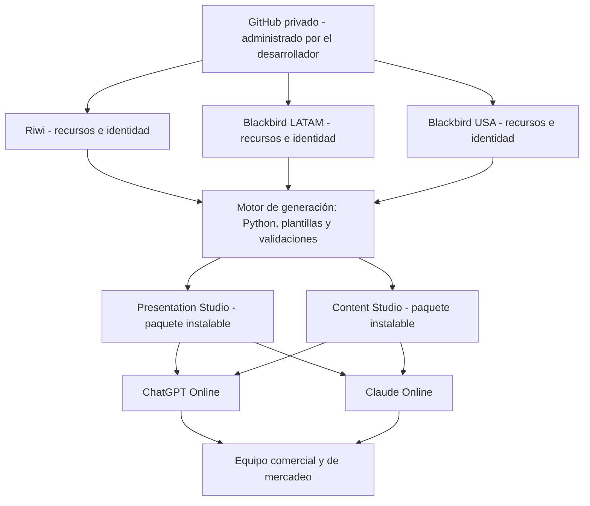

# Brand Studio — Plan de trabajo

## 1. Idea del proyecto

Construir una herramienta corporativa que permita a los equipos comerciales y de mercadeo de **Riwi, Blackbird LATAM y Blackbird USA** generar presentaciones, propuestas comerciales y contenido para redes sociales directamente desde ChatGPT o Claude, respetando la identidad visual y verbal de cada marca.

La herramienta contará con un repositorio privado que centralizará los diseños, plantillas, recursos gráficos, información corporativa, reglas de marca y scripts de generación.

Estos recursos se distribuirán mediante Skills instalables en ChatGPT y Claude, aprovechando las suscripciones existentes, sin necesidad de contratar APIs, servidores o desarrollar una plataforma web adicional.

### Ambientes de trabajo

| Presentation Studio | Content Studio |
|---|---|
| Equipo comercial | Mercadeo y comunicaciones |
| Presentaciones comerciales y corporativas | Publicaciones y carruseles |
| Propuestas comerciales y cotizaciones | Historias y banners |
| Casos de éxito y one-pagers | Contenido comercial y copy para redes sociales |
| Formatos: PPTX, DOCX y PDF | Formatos: PNG, JPG y SVG |

Ambos ambientes tendrán acceso a los recursos oficiales de las tres marcas, conservando sus identidades de manera independiente.

## 2. Arquitectura de la herramienta



Los usuarios finales generan archivos mediante lenguaje natural, sin código, sin GitHub y sin APIs adicionales.

## 3. Herramientas que vamos a utilizar

| Herramienta | Función dentro del proyecto | Usuario |
|---|---|---|
| GitHub | Repositorio privado, almacenamiento y control de versiones. | Desarrollador |
| Claude Code | Desarrollo y mantenimiento de la herramienta. | Desarrollador |
| Python | Construcción de los motores de generación y validación. | Desarrollador |
| GitHub Actions | Empaquetado y publicación de nuevas versiones. | Desarrollador |
| Agent Skills | Distribución de instrucciones, plantillas, recursos y scripts. | Desarrollador |
| ChatGPT Online | Generación de presentaciones y contenido. | Equipo comercial y mercadeo |
| Claude Online | Generación de presentaciones y contenido. | Equipo comercial y mercadeo |

### Librerías de desarrollo

| Librería | Función |
|---|---|
| `python-pptx` | Generación de presentaciones PowerPoint. |
| `python-docx` | Generación de documentos Word. |
| `Pillow` | Generación y composición de imágenes. |
| `CairoSVG` | Renderizado de elementos gráficos vectoriales. |
| `Jinja2` | Generación mediante plantillas dinámicas. |
| `ReportLab` | Generación de documentos PDF. |
| `jsonschema` | Validación de información y estructuras. |
| `pytest` | Pruebas automatizadas. |
| `zipfile` | Empaquetado de las Skills. |

## 4. Estructura del repositorio

Se utilizará un único repositorio privado, dividido internamente por marcas y ambientes de generación.

```text
brand-studio/
├── brands/
│   ├── riwi/
│   ├── blackbird-latam/
│   └── blackbird-usa/
├── engines/
│   ├── presentations/
│   └── content/
├── knowledge/
│   ├── company-information/
│   ├── services/
│   ├── commercial-rules/
│   └── tone-of-voice/
├── skills/
│   ├── presentation-studio/
│   │   └── SKILL.md
│   └── content-studio/
│       └── SKILL.md
├── tests/
├── build/
├── dist/
│   ├── presentation-studio.zip
│   └── content-studio.zip
├── CLAUDE.md
├── README.md
└── VERSION
```

Dentro del repositorio se almacenarán los siguientes recursos de cada marca:

- Manuales de identidad visual y verbal.
- Logos, tipografías, colores e iconografía.
- Fotografías, fondos, texturas y elementos gráficos.
- Plantillas oficiales de PowerPoint y Word.
- Diseños aprobados de publicaciones, historias y carruseles.
- Información corporativa, servicios y cifras oficiales.
- Reglas de generación, composición y comunicación.
- Scripts de generación y validación.

## 5. Distribución de la herramienta

El desarrollador construirá dos paquetes autocontenidos que incluirán todos los recursos necesarios para su funcionamiento.

| Paquete | Contenido |
|---|---|
| `presentation-studio.zip` | Plantillas, instrucciones, recursos y generadores de presentaciones de las tres marcas. |
| `content-studio.zip` | Plantillas, instrucciones, recursos y generadores de contenido de las tres marcas. |

Estos paquetes se instalarán como Skills dentro de ChatGPT y Claude y se compartirán con los usuarios del espacio de trabajo corporativo, según las capacidades de administración de cada plataforma.

Los comerciales no necesitarán acceder al repositorio. Las actualizaciones serán responsabilidad del desarrollador.

## 6. Cómo lo utilizarán los comerciales

La experiencia será completamente conversacional. Los usuarios ingresarán directamente a ChatGPT o Claude desde su navegador y solicitarán el material que necesitan.

### Ejemplo de uso — Presentation Studio

**Comercial:** Necesito una presentación comercial de Blackbird USA para una empresa del sector financiero interesada en servicios de inteligencia artificial.

**IA:** Para generar la presentación con la identidad oficial de Blackbird USA, necesito los siguientes datos:

- Nombre de la empresa.
- Servicios que deseas presentar.
- Cantidad de diapositivas.
- Idioma.

**Comercial:** Empresa ABC, AI Solutions y automatización. 8 diapositivas, en inglés.

**IA:** La presentación ha sido generada utilizando las plantillas y recursos corporativos de Blackbird USA.

**Resultado:** `BBUSA_ABC_Proposal.pptx` — 8 diapositivas, PowerPoint editable.

*Simulación de la experiencia de usuario.*

### Flujo interno de generación

1. Recibir la solicitud del usuario.
2. Identificar la marca y el tipo de contenido.
3. Consultar la información corporativa disponible.
4. Seleccionar las plantillas y recursos aprobados.
5. Generar el contenido solicitado.
6. Ejecutar los scripts de generación.
7. Validar el cumplimiento de las reglas de marca.
8. Entregar el archivo final al usuario.

Los comerciales podrán solicitar modificaciones dentro de la misma conversación y descargar los archivos resultantes.

## 7. Administración y mantenimiento

El desarrollador será responsable de actualizar los recursos, plantillas, reglas y scripts desde el repositorio privado.

Cada actualización generará una nueva versión de los paquetes, que será publicada en ChatGPT y Claude mediante los mecanismos de distribución disponibles.

Los usuarios finales no tendrán que gestionar código, dependencias o repositorios. La propagación de las actualizaciones dependerá de las capacidades administrativas de cada plataforma.

## 8. Costos adicionales

| Recurso | Costo adicional previsto |
|---|---|
| GitHub privado | $0 |
| GitHub Actions | $0 dentro de la cuota gratuita |
| Python y librerías | $0 |
| Agent Skills | Incluidas en planes compatibles |
| ChatGPT | Suscripción existente |
| Claude | Suscripción existente |
| APIs de inteligencia artificial | $0 |
| Hosting y servidores | No requeridos |
| Bases de datos | No requeridas |

**Objetivo de costo recurrente adicional: USD $0/mes.**

Sujeto a las funcionalidades y límites de las suscripciones existentes. No incluye el esfuerzo de desarrollo y mantenimiento.

## 9. Principios fundamentales del proyecto

- **Facilidad de uso:** cualquier comercial podrá generar materiales mediante lenguaje natural.
- **Consistencia de marca:** los resultados utilizarán plantillas, recursos y reglas previamente aprobados.
- **Administración centralizada:** el desarrollador controlará el repositorio y las actualizaciones.
- **Independencia técnica para los usuarios:** no necesitarán GitHub, programación ni instalaciones locales.
- **Sin APIs adicionales:** se aprovecharán las suscripciones existentes de ChatGPT y Claude.
- **Escalabilidad:** se podrán incorporar nuevas plantillas, diseños y funcionalidades dentro de los mismos ambientes.

La propuesta excluye completamente Figma. Antes de implementar todo el sistema, será necesario validar la ejecución de los scripts, las dependencias, las tipografías y la generación de archivos en ambas plataformas.

**El objetivo final es convertir ChatGPT y Claude en herramientas corporativas de generación de materiales comerciales y de comunicación, manteniendo el control de las marcas desde un único repositorio privado y ofreciendo una experiencia sencilla para todos los usuarios.**
